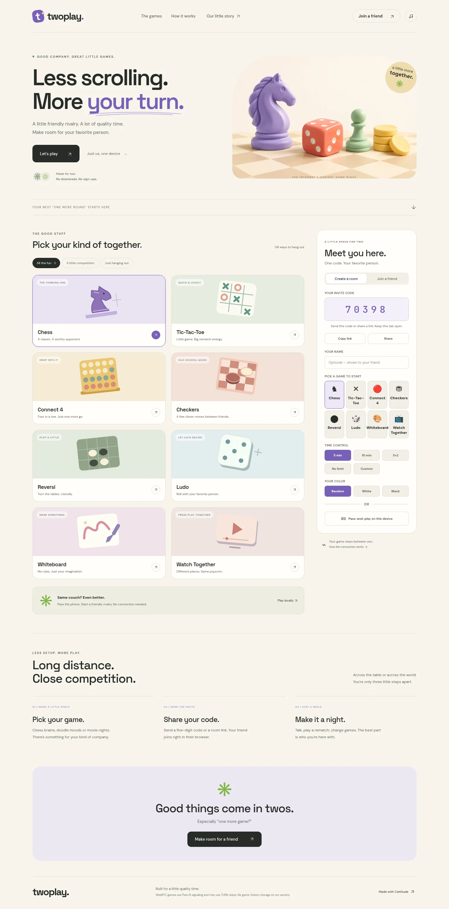

# Twoplay — less scrolling, more your turn

A responsive browser lounge for two: **Chess, Tic-Tac-Toe, Connect 4, Checkers,
Reversi, Ludo, Whiteboard and Watch Together**. Play across two browsers or pass
one device between friends. No account required.



[Mobile preview](docs/previews/lounge-390.webp) · [Game room](docs/previews/arena-1440.webp)

## Run locally

Requires **Node.js 20.19+** (22 LTS recommended).

```sh
npm ci
npm run dev
```

Open the local URL printed by Vite. Serve the website over HTTP locally and HTTPS
in production; opening `index.html` directly is no longer the supported workflow.

```sh
npm test                        # protocol, chess and lifecycle regressions
npm run build                   # creates the deployable dist/ directory
npm run preview -- --port 8861   # preview the production build
TWOPLAY_TEST_URL=http://localhost:8861/ npm run test:browser
```

Browser checks require Chromium. Run `npx playwright install chromium` if it is
not installed; use `CHROMIUM_PATH` to select an existing browser.

## Project structure

```text
index.html                  Semantic page, room and game-panel markup
src/core/protocol.js         Peer input validation, safe queue records, uniform dice
src/core/connection.js       Peer connection, joining and recovery
src/core/voice.js            Caller validation, permission and audio lifecycle
src/core/session.js          Session state, dispatcher, clocks and game lifecycle
src/core/chrome.js           Shared chrome, sound and scoreboard
src/core/boot.js             Startup after all controllers have registered
src/games/                  One active controller per activity
src/ui/lounge.js            Game library, filters and accessible dialog behavior
src/ui/cursors.js           Optional desktop cursor controls
src/ui/customization.js     Room/board skins, movement styles and credits
src/ui/music.js             Playlist discovery and the cozy music player
src/styles/                 Foundation/game styles and the responsive lounge design
src/vendor/                 Retained chess engine and PeerJS entry point
public/assets/              AI hero artwork, cursor images, local fonts and licenses
public/music/               Existing tracks and the maintained playlist manifest
scripts/                    Local vendor preparation and production build
tests/                     Focused regressions and browser checks
docs/                      Migration notes, limitations and archived prototype
```

The source now has separate game, UI, network and style files. Controllers retain
an explicit shared classic-script session contract to preserve existing game
behavior. Deferred script order is declared in `index.html`; do not make these
scripts `async`. `GameControllers` owns each game's lifecycle. `initGame()` calls
the outgoing controller's `deactivate()` before activating the next one.

The production build bundles the pinned PeerJS dependency locally, minifies and
hashes executable/style files, and copies public assets. Fonts are self-hosted.
Cursor strips load as separate images rather than embedded JavaScript. The music
library is **not downloaded with the initial page**; playback uses selected files.

## Deployment

For **Vercel**, import this repository. The included `vercel.json` runs
`npm run build` and publishes `dist/`. Preview branches can be reviewed before
merging to `main`. For Netlify/Cloudflare Pages, use the same build command/output.
For the connected **Cloudflare Workers Builds** service, `wrangler.jsonc` declares
the static assets and runs the production build before deployment (`npx wrangler deploy`).

For a subpath such as GitHub Pages, publish the **contents of `dist/`**, not the
source root. Generated script, style, font and image URLs support project subpaths.
Microphone access requires HTTPS (or localhost).

## Connection and privacy

PeerJS signaling helps browsers discover each other. WebRTC carries game data;
TURN may relay it when direct connectivity is unavailable. These external
services still participate: this is **not** a claim of zero-server networking.
There is no application game-history backend. Preferences and the last room code
are stored locally. Reloading does not restore a completed board.

Voice requires the connected opponent's identity and explicit acceptance before
requesting microphone access. Incoming messages are bounded and validated; board
moves are checked against the current turn/rules. This remains a casual P2P
application, **not a cheat-proof competitive service**: a modified peer controls
its own program and a dishonest host can falsify authoritative snapshots.

The existing TURN configuration is deliberately unchanged at the owner's request.
Watch Together still uses YouTube's iframe and the existing remote API-key-list
configuration. Search loads that configuration only when requested. Public browser
API keys should have suitable provider restrictions; no claim of key secrecy is made.
Video availability, embedding restrictions, search quota, autoplay and microphone
permissions depend on the provider/browser.

## Design and provenance

The lounge hero was generated with OpenAI's image-generation tool and exported as
an optimized WebP. Game-card illustrations are local SVGs. Existing mascot, music,
cursor artwork and chess assets were retained; their presence does not establish
new redistribution rights. Variable fonts ship with their original license files
under `public/assets/fonts/`. See [redesign notes](docs/REDESIGN.md) for changes and
verification limits.
